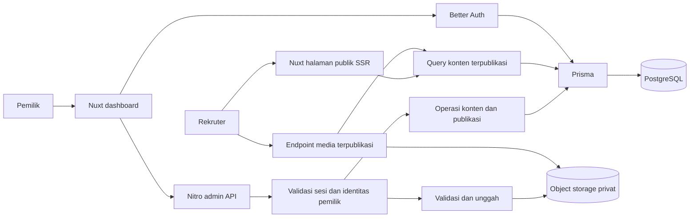

# Architecture Design

Status: rancangan teknis untuk ditinjau, belum diimplementasikan. Referensi: [PRD](../01-product/prd.md). Tanggal: 28 Oktober 2026.

**Pembaruan 29 Oktober 2026:** pengguna memilih SQLite dan development lokal. Implementasi menggunakan satu proses Node, SQLite melalui Prisma/libSQL, dan direktori media privat lokal. Diagram dan pilihan PostgreSQL/object storage di bawah adalah rancangan awal yang tidak lagi menggambarkan konfigurasi lokal. Hosting produksi, persistensi file, backup, serta pembatasan multi-instance belum ditetapkan dan belum divalidasi.

## 1. Konteks dan batas

Repository berisi instruksi dan PRD, tanpa source code, manifest dependency, migrasi, atau test. Desain ini memenuhi portfolio bilingual untuk rekruter dan dashboard satu pemilik. Tidak mencakup blog, portal klien, registrasi publik, atau implementasi desain visual.

Dokumen terkait: [database](database.md), [API](api-spec.md), [UI/UX](ui-ux.md), dan [keamanan](security.md). Semua pilihan teknis baru di bawah merupakan usulan implementasi, bukan klaim konfigurasi yang sudah berjalan.

## 2. Arsitektur

Gunakan satu aplikasi Nuxt dengan TypeScript, SSR untuk halaman publik, dan Nitro sebagai backend satu origin. Tidak memisahkan microservice atau membuat backend tambahan.

Nuxt menyediakan registrasi handler server/API melalui direktori server; SSR dan dashboard menggunakan backend yang sama. Lihat [dokumentasi Nuxt di repository resmi](https://github.com/nuxt/nuxt/blob/main/docs/1.getting-started/13.server.md).

Better Auth dipasang pada catch-all `/api/auth/*`, menggunakan client Vue dan adapter Prisma untuk PostgreSQL sesuai [integrasi Nuxt](https://better-auth.com/docs/integrations/nuxt) dan [adapter Prisma](https://better-auth.com/docs/adapters/prisma). Middleware halaman membantu navigasi; otorisasi tetap diperiksa di setiap endpoint admin.

## 3. Batas modul

| Modul | Tanggung jawab |
| --- | --- |
| Public portfolio | Membaca konten published, memilih bahasa, metadata SEO, dan 404. |
| Admin content | CRUD, urutan, preview privat, validasi dua bahasa, dan transisi publikasi. |
| Auth | Login, sesi, logout, pemeriksaan identitas pemilik; tanpa sistem role tambahan. |
| Media | Upload terautentikasi, metadata, penyimpanan privat, streaming dengan pemeriksaan akses. |
| Persistence | Client Prisma bersama, constraint, transaksi, dan migrasi. |

Gunakan fungsi domain bersama untuk query publik dan validasi publikasi agar SSR dan API tidak memiliki aturan berbeda. Hindari repository wrapper generik atau event bus. Adapter storage dibuat hanya sejauh dibutuhkan integrasi provider terpilih.

Struktur yang diusulkan: halaman/komponen di `app/`, handler dan fungsi server di `server/`, schema/migrasi di `prisma/`, pengujian di `tests/`. Tidak membuat struktur ini pada tahap dokumentasi.

## 4. Alur konten dan publikasi

- Profile, Project, Experience, dan Resume menggunakan status DRAFT atau PUBLISHED.
- Pembuatan selalu DRAFT. Save tidak memublikasikan.
- Publish memvalidasi dua bahasa, relasi media READY, serta field wajib dalam transaksi.
- Untuk MVP tanpa revision history, konten PUBLISHED tidak dapat diedit atau dihapus langsung: API mengembalikan 409. Pemilik harus melakukan unpublish secara eksplisit, mengedit, lalu publish kembali.
- UI wajib menjelaskan bahwa unpublish menghilangkan konten dari publik sementara. Ini adalah trade-off usulan yang harus ditinjau sebelum implementasi, terutama untuk profil dan CV. Mempertahankan versi lama saat mengedit membutuhkan desain revision terpisah.
- Skill merupakan label bersama tanpa draft; simpan, urutkan, atau hapus langsung memengaruhi daftar publik. UI menjelaskan perilaku ini.
- Dua bahasa disimpan bersama dalam satu operasi edit. Draft boleh belum lengkap, tetapi nilai yang diberikan tetap harus valid.
- Update menggunakan nomor version; perubahan dari tab lama ditolak dengan 409, bukan menimpa diam-diam.

## 5. Media dan konsistensi

Bucket selalu privat. Browser mengirim file ke Nitro; server memverifikasi akses, ukuran dan isi, lalu menyimpan dengan object key acak. Tidak menerima URL remote untuk diunduh server.

Upload baru menghasilkan Media READY yang belum publik. File baru ditautkan ke draft hanya setelah upload berhasil; gagal upload tidak mengubah referensi lama. Metadata reservation/status UPLOADING menampung reservasi kuota sebelum transfer; kegagalan dibersihkan atau ditandai FAILED untuk retry pembersihan.

Publik mengakses file melalui endpoint aplikasi yang memeriksa referensi dari konten PUBLISHED. Jangan memberikan public bucket URL atau presigned URL kepada pengunjung. Media tanpa referensi published menghasilkan 404. Media yang juga dipakai konten published lain tetap publik; UI mengingatkan bahwa file bersama tersebut bukan draft privat.

MVP menggunakan respons publik, admin, dan media dengan Cache-Control: no-store untuk memastikan unpublish langsung dihormati pada request berikutnya. Optimasi cache dilakukan kemudian dengan strategi invalidasi teruji. File yang sudah diunduh pengunjung tidak dapat ditarik kembali.

## 6. Pilihan platform dan trade-off

| Pilihan | Alasan / batas |
| --- | --- |
| Nuxt 4 sebagai target awal | Satu aplikasi SSR dan API; versi patch ditetapkan setelah pemeriksaan kompatibilitas. |
| Prisma + PostgreSQL | Sesuai PRD; constraint dan transaksi untuk perubahan terkait. |
| Better Auth | Tidak menulis password hashing atau sesi sendiri. |
| Object storage privat kompatibel S3 | File persisten di luar filesystem proses; provider belum dipilih. |
| Runtime Node.js | Menghindari asumsi kompatibilitas edge; major mengikuti dukungan seluruh dependency. |
| Terjemahan id/en eksplisit | Tanpa auto-detect atau fallback bahasa yang menyembunyikan konten belum lengkap. |
| Plain text untuk narasi | Tanpa HTML mentah atau rich text editor pada MVP. |

Versi Nuxt, Prisma, Better Auth, Node.js, serta paket adapter belum dikunci. [Dokumentasi adapter Better Auth](https://better-auth.com/docs/adapters/prisma) yang ditinjau menggunakan Prisma 7, sedangkan [halaman transaksi Prisma](https://www.prisma.io/docs/orm/fundamentals/transactions) terkini membahas Prisma 8; jangan menggabungkan contoh lintas major. Sebelum instalasi, pilih kombinasi yang benar-benar didukung, lakukan audit dependency sesuai instruksi project, dan buktikan login/query/migrasi melalui smoke test. Tidak ada dependency yang diinstal pada tahap ini.

## 7. Validasi, deployment, dan keputusan terbuka

Usulan pengujian: Vitest untuk aturan domain/integrasi, PostgreSQL test terisolasi untuk transaksi/constraint, dan Playwright untuk alur browser. Dependency test tetap melalui pemeriksaan sebelum instalasi. Gunakan contoh konten sintetis, bukan data produksi.

| Cakupan | Pembuktian |
| --- | --- |
| FR-001–FR-004 | Rendering locale, detail proyek, urutan pengalaman/skill, dan perpindahan bahasa. |
| FR-005–FR-006 | Draft privat, publikasi lengkap, konflik version, serta gagal simpan mempertahankan input. |
| FR-007–FR-009 | Auth, penolakan akses, upload gagal, CV per bahasa, dan kontak. |
| FR-010 / NFR | SEO, 404, keyboard, viewport 360/768/1440, validasi server, dan rate limit. |

Sebelum rilis: build, typecheck, lint, test domain/integrasi/E2E, staging smoke test, serta restore backup. Migrasi dijalankan satu kali oleh release process, bukan setiap request. Backup sebelum migrasi; rollback aplikasi hanya jika schema kompatibel, selain itu restore terkontrol.

TBD: provider hosting/database/storage, anggaran, domain, versi dependency, dan desain visual pengguna. Ambang operasional usulan ada di security.md. Tidak melakukan deployment atau membuat task breakdown dalam fase ini.

