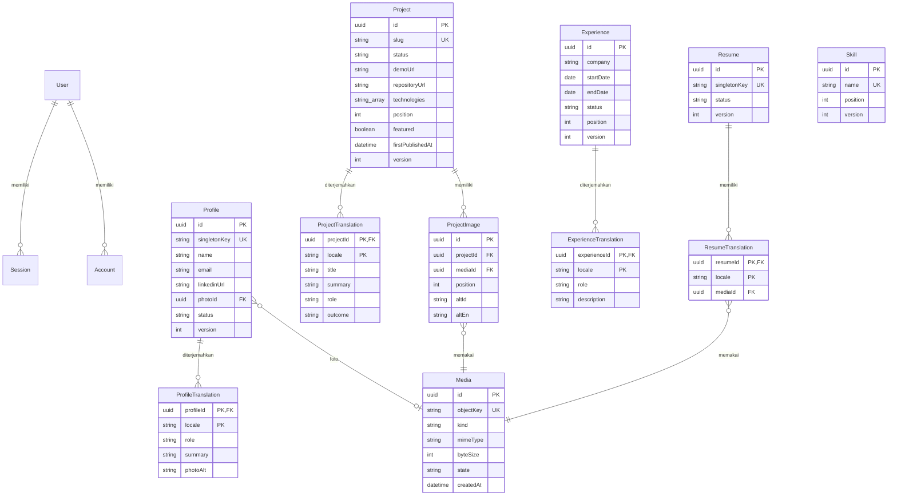

# Database Design dan ERD

Status: rancangan untuk ditinjau. Referensi: [PRD](../01-product/prd.md), [arsitektur](architecture.md), [kontrak API](api-spec.md).

**Pembaruan 29 Oktober 2026:** SQLite menggantikan PostgreSQL sesuai keputusan pengguna. Schema dan migrasi aktual berada di `prisma/`; bagian PostgreSQL di bawah adalah rancangan awal dan harus ditinjau ulang untuk batas SQLite sebelum rilis.

## 1. Konvensi

PostgreSQL melalui Prisma. ID domain menggunakan UUID; ID tabel autentikasi mengikuti schema Better Auth yang dihasilkan versi terpilih. Waktu audit disimpan UTC. Tanggal pengalaman menggunakan tipe date, ditransfer sebagai YYYY-MM-DD.

Entitas yang dapat diedit memiliki createdAt, updatedAt, dan version integer mulai 1. Status konten: DRAFT atau PUBLISHED, default DRAFT. Translation locale dibatasi id/en dengan unique gabungan parentId + locale. Slug proyek unik global, sama untuk kedua bahasa, dan tidak dapat diubah setelah proyek pertama kali dipublikasikan.

Schema berikut konseptual; bukan migration siap jalan. Tabel autentikasi dihasilkan dari konfigurasi Better Auth dan ditinjau sebelum migrasi, bukan disalin dari asumsi schema.

## 2. ERD

User, Session, Account, serta Verification adalah model milik Better Auth; hanya relasi utama digambarkan. Model Verification dan tabel rate limit mengikuti kebutuhan konfigurasi versi terpilih. Detail password/token tidak masuk DTO aplikasi.

## 3. Definisi dan invariant

| Entitas | Aturan |
| --- | --- |
| Profile | Satu record, singletonKey bernilai main. Nama dan kontak shared; role, summary, photoAlt dua bahasa. Foto harus IMAGE READY. |
| Project | Slug lowercase kebab-case 1–100 karakter. technologies adalah array label, maksimal 30. Maksimal 20 gambar; position menentukan urutan. |
| Experience | company shared; role/description diterjemahkan. endDate null berarti masih berlangsung; selain itu endDate tidak sebelum startDate. |
| Skill | Label shared 1–80 karakter; unique nama setelah trim dan normalisasi lowercase untuk pemeriksaan duplikat. |
| Resume | Singleton main; dua relasi locale ke Media PDF READY. Mengganti CV mengikuti unpublish/edit/publish. |
| Media | kind IMAGE atau PDF; state UPLOADING, READY, FAILED, atau DELETING. Object key immutable dan tidak diekspos publik. byteSize untuk reservasi kuota sebelum READY. |
| Translation | Draft boleh null/belum lengkap. Saat publish wajib tepat id dan en dengan semua field wajib nonblank. |

Gunakan constraint PostgreSQL untuk locale, singletonKey, panjang/format penting, ukuran positif, date range, dan version positif jika tidak dapat dinyatakan oleh Prisma. Unique nama Skill memakai indeks normalisasi melalui migrasi SQL bila diperlukan. Pemeriksaan aplikasi melengkapi constraint, bukan menggantikannya.

Field panjang umum mengikuti API. Tidak menyimpan HTML. Position integer nonnegatif; tie diurutkan dengan id sebagai pembanding stabil. Indeks (status, position, id) untuk Project/Experience; unique slug untuk detail; indeks setiap FK media untuk pemeriksaan akses/referensi.

## 4. Publikasi dan update atomik

Dalam transaksi, baca record, cocokkan version, pastikan DRAFT, validasi kedua terjemahan dan media, lalu update status PUBLISHED serta increment version. firstPublishedAt hanya diisi saat publikasi proyek pertama. Pembacaan publik selalu menyertakan filter status.

Update menggunakan operasi bersyarat terhadap id + version; jika tidak cocok, rollback dengan konflik 409. Perubahan parent, translations, dan daftar gambar disimpan atomik. PUBLISHED tidak dapat diedit/dihapus sebelum explicit unpublish. Skill tidak memiliki status publikasi.

Transaksi mencegah data parsial; pemanggilan object storage tidak dimasukkan ke transaksi database yang panjang. Prinsip atomic writes mengacu pada [dokumentasi transaksi Prisma](https://www.prisma.io/docs/orm/fundamentals/transactions); sintaks API harus mengikuti major yang akhirnya dipilih.

## 5. Penghapusan dan media

- Menghapus draft Project/Experience menghapus translations dan ProjectImage terkait melalui cascade.
- Profile dan Resume adalah singleton yang diperbarui/unpublish, tidak dihapus melalui API.
- Menghapus konten tidak langsung menghapus file storage.
- FK media menggunakan RESTRICT. File yang masih direferensikan, termasuk draft, tidak boleh dihapus.
- Penghapusan Media: kunci record, pastikan tanpa referensi, set DELETING, hapus object, lalu metadata. Kegagalan storage meninggalkan DELETING untuk retry; file tersebut tidak dapat ditautkan lagi.
- Attach dan publish hanya menerima READY; operasi attach/delete harus memakai penguncian record media yang sama agar tidak terjadi race.
- Reservation kuota dihitung atomik dalam PostgreSQL dengan lock transaksi bersama untuk semua upload. Seluruh state yang masih mengonsumsi storage dihitung; reservasi dilepas hanya setelah cleanup berhasil.
- Upload yatim atau UPLOADING yang macet direkonsiliasi melalui operasi pemeliharaan manual terautentikasi operator sebelum mengaktifkan cron otomatis.

## 6. Migrasi, seed, dan backup

Migrasi awal membuat tabel auth hasil generator, domain, FK, dan indeks. Review SQL sebelum diterapkan. Gunakan database development/test/staging terpisah; jangan menjalankan reset atau migrasi development terhadap produksi.

Seed domain membuat singleton DRAFT kosong; tidak memasukkan password atau akun contoh ke produksi. Provisioning akun pemilik dijelaskan di security.md.

Usulan backup: database harian retensi 7 hari dan backup/versioning object storage privat; target RPO 24 jam, RTO 4 jam harus dibuktikan melalui restore staging. Provider dan biaya belum dipilih. Backup database dan file direkonsiliasi berdasarkan object key; restore database saja belum cukup untuk memulihkan CV/gambar.

